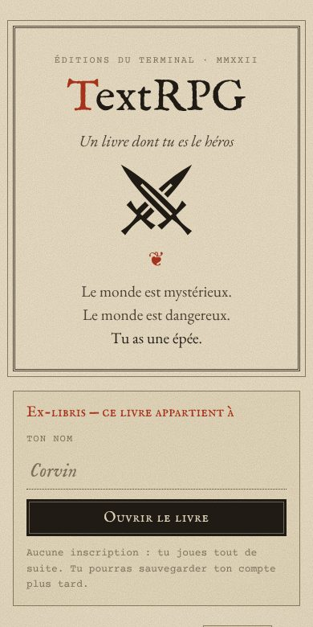
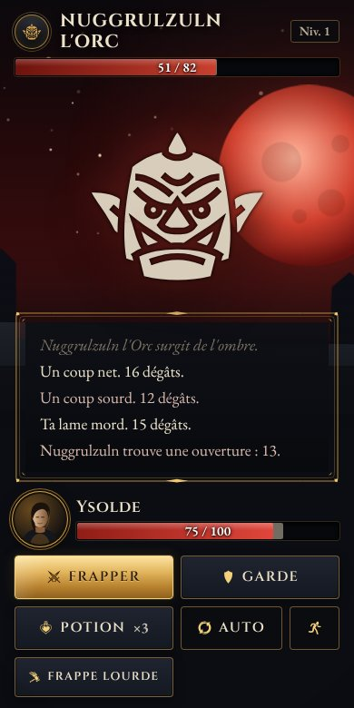
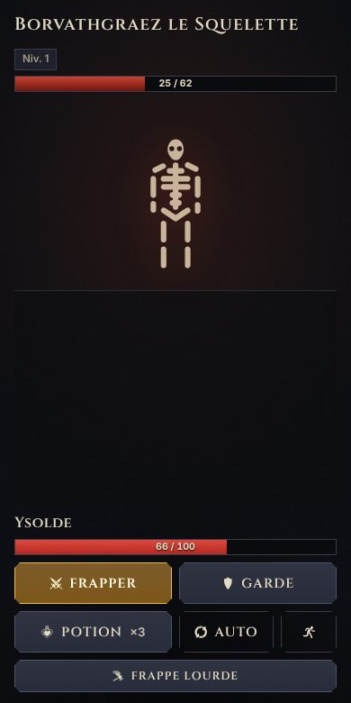
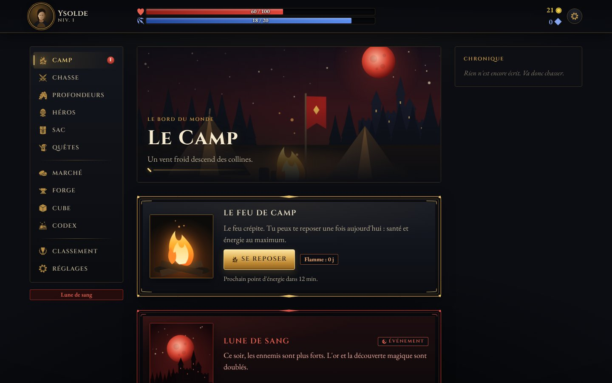

# TextRPG

[](https://github.com/RemiPelloux/TextRPG/actions/workflows/ci.yml)


> *Le monde est mystérieux. Le monde est dangereux. Tu as une épée.*

Un RPG sombre qui se joue **au choix**, dans le navigateur ou installé sur ton téléphone.
Chasse, loot à la Diablo, donjons, quêtes, classes : une histoire qui se lit comme un grimoire,
un jeu qui se joue en sessions courtes, rythmées par l'énergie.

<p align="center">
  
  
  
</p>
<p align="center"></p>

## Ce que contient le jeu (v1.1)

| | |
|---|---|
| **Combat** | Tour par tour, initiative par la vitesse, critiques liés à la chance, esquive, garde, coups télégraphés des boss, effets d'état (poison, brûlure, saignement, étourdissement…), mode automatique. Une chronique raconte chaque coup. |
| **Loot à la Diablo** | Raretés Commun → Magique → Rare → Légendaire → Set → Ancestral, 30 affixes à 5 paliers, objets **non identifiés**, protection contre la malchance, probabilités affichées. |
| **Objets infinis** | Chaque objet est unique : matière, qualité, numéro de série, provenance (« Arraché à Grakthor l'Orc »), 17 **pouvoirs générés**, **légendaires procéduraux** avec nom et légende, en plus de 13 légendaires et 4 sets faits main. |
| **Sceaux et Cube** | 9 **sceaux** (sets procéduraux) dont les bonus démarrent à 2 pièces dès le niveau 1. Le **Cube** : transmuter, enchanter (1 parmi 3), infuser un sceau, reforger, extraire le pouvoir d'un légendaire. |
| **Progression** | Niveaux 1 → 20 avec les gains de la version originale, 3 classes au niveau 5 (Guerrier, Rôdeur, Occultiste), compétences, talents, puis **Parangon** à l'infini et 10 **Tourments**. |
| **Monde** | Le Camp et son feu (repos quotidien, flamme de série), 4 difficultés de chasse (dont l'**Enfer**), la **lune de sang** du samedi, le boss de la semaine, les **Profondeurs** (étages, portes, événements, gardiens, butin perdu si tu meurs). |
| **Quêtes** | L'**Acte I** en 10 chapitres jusqu'au Roi Creux, un tableau d'annonces, 3 quêtes du jour. |
| **Économie** | Marché renouvelé chaque jour, forge (amélioration +10, relance d'affixe, recyclage en éclats), alchimiste, pêche (mini-jeu de lecture du poisson), bâtiments du camp. |
| **Social** | Défi quotidien (mêmes ennemis pour tous), classements, succès, codex. |
| **Plateforme** | PWA installable, responsive mobile → desktop, hors ligne en consultation, notifications opt-in, FR/EN, son synthétisé, accessibilité (mouvement réduit, contraste élevé, taille du texte). |
| **Fiabilité** | Le serveur décide de tout (énergie, loot, combats) : pas de triche en changeant l'heure. Sauvegarde versionnée, verrou optimiste, 150 tests automatisés, équilibrage vérifié par des bots qui jouent des semaines. |

## Jouer en local

Prérequis : **Node 22+**, **pnpm 10**, **Postgres 16** (ou Docker).

```bash
git clone https://github.com/RemiPelloux/TextRPG.git
cd TextRPG
pnpm install
pnpm db:up                  # Postgres via Docker (ou ton propre Postgres)
cp apps/web/.env.example apps/web/.env.local
pnpm db:migrate
pnpm dev                    # http://localhost:3000
```

Aucune inscription : un compte invité est créé à la première partie. Tu peux le sauvegarder
avec un e-mail plus tard (écran Compte).

## Développer

```bash
pnpm test           # contenu + moteur + interface (unitaires)
pnpm test:server    # service de jeu contre Postgres
pnpm e2e            # Playwright, mobile et desktop (après `pnpm build`)
pnpm lint && pnpm format:check && pnpm typecheck
pnpm simulate       # rapport d'équilibrage : victoires par niveau et difficulté
pnpm simulate:progression 30 6 --check   # des bots jouent 30 jours, cibles de docs/BALANCE.md
pnpm simulate:bench # coût du moteur par action
```

Deux agents Claude Code sont fournis dans `.claude/agents/` : **balance-keeper** (mesure et retouche l'équilibrage) et **loot-smith** (contenu de butin, sceaux, pouvoirs). Dans Claude Code : « utilise balance-keeper pour vérifier l'équilibrage après mon changement ». Le workflow **Balance** les complète chaque lundi.

## Structure

```
apps/web/            Next.js 16 (App Router) : écrans, Server Actions, PWA
packages/engine/     le jeu : une fonction pure apply(state, action) → { state, events }
packages/content/    tout le contenu en JSON, validé par Zod (objets, ennemis, quêtes…)
packages/db/         schéma Postgres (Drizzle), migrations, requêtes
packages/server/     comptes, service de jeu autoritaire, validation des actions
tools/simulate/      simulateurs : combats, bots de progression, bench, test de charge
legacy/python/       la version Python v0.2 (et le prototype de 2022 dans l'historique git)
docs/                architecture, déploiement, game design, direction artistique, roadmap
```

## Documentation

| Document | Contenu |
|---|---|
| [docs/ARCHITECTURE.md](docs/ARCHITECTURE.md) | Comment le jeu est construit, et comment ajouter du contenu |
| [docs/DEPLOY.md](docs/DEPLOY.md) | Mettre le jeu en ligne (Vercel + Neon), notifications, cron |
| [docs/web/GAME_DESIGN.md](docs/web/GAME_DESIGN.md) | Boucles de jeu, combat, loot, rétention éthique |
| [docs/web/ART_DIRECTION.md](docs/web/ART_DIRECTION.md) | La direction artistique « Grimoire sombre » |
| [docs/web/PLAN.md](docs/web/PLAN.md) | Le plan de refonte et les décisions prises en chemin |
| [docs/BALANCE.md](docs/BALANCE.md) | Cibles d'équilibrage, leviers, méthode |
| [docs/SCALABILITY.md](docs/SCALABILITY.md) | Mesures de charge et prochains paliers |
| [docs/ROADMAP.md](docs/ROADMAP.md) | La suite : Acte II, saisons, multijoueur asynchrone… |
| [CONTRIBUTING.md](CONTRIBUTING.md) | Conventions et workflow |
| [CHANGELOG.md](CHANGELOG.md) | L'histoire du projet, de 2022 à la v1.1 |

## Crédits

Icônes : [game-icons.net](https://game-icons.net) (CC BY 3.0) — Lorc, Delapouite et contributeurs.
Polices : Cinzel, Spectral, Inter (SIL Open Font License).
