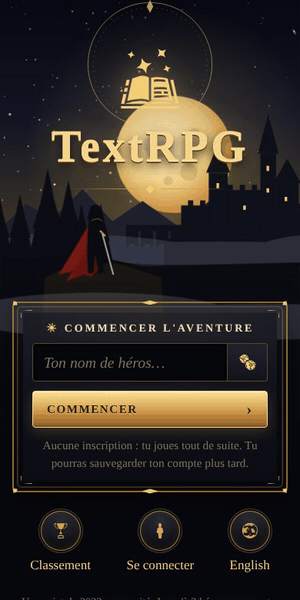
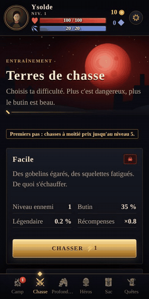
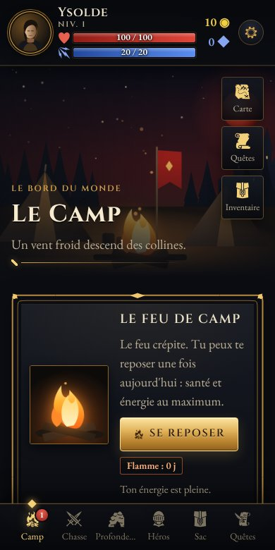
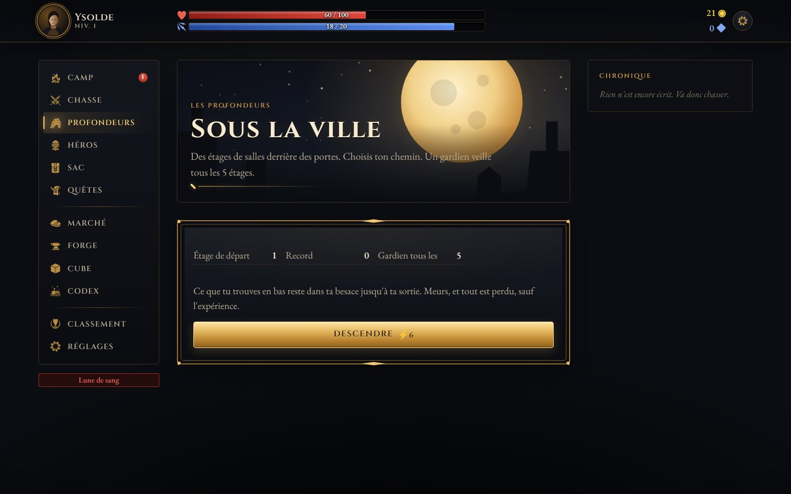
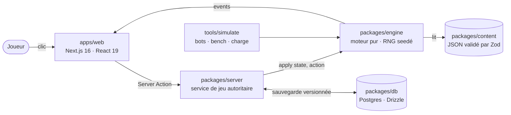

<p align="center">
  
</p>

<p align="center">
  <a href="https://github.com/RemiPelloux/TextRPG/actions/workflows/ci.yml"></a>
  
  
  
  
  
</p>

<p align="center">
  <b>Un RPG de dark fantasy qui se joue au texte</b>, dans le navigateur ou installé sur ton téléphone.<br>
  Chasse, loot à la Diablo, donjons, quêtes et classes, en sessions courtes rythmées par l'énergie.
</p>

<p align="center">
  <a href="#-jouer-en-local"><b>Jouer en local</b></a> ·
  <a href="#-le-jeu">Le jeu</a> ·
  <a href="#-direction-artistique--nuit-dorée">Direction artistique</a> ·
  <a href="#-sous-le-capot">Sous le capot</a> ·
  <a href="#-documentation">Documentation</a>
</p>

<p align="center"></p>

## ✦ En mouvement

<table align="center">
  <tr>
    <td align="center" width="50%">
      <br>
      <sub><b>L'arrivée.</b> La lune respire, la brume dérive, la cape flotte. Un nom, et te voilà au camp.</sub>
    </td>
    <td align="center" width="50%">
      <br>
      <sub><b>Le combat.</b> La chronique raconte chaque coup, les dégâts s'envolent, le butin tombe.</sub>
    </td>
  </tr>
</table>

<p align="center">
  
  
  
</p>

<p align="center"></p>

<p align="center"></p>

## ⚔ Le jeu

| | |
|---|---|
| **Combat** | Tour par tour : initiative par la vitesse, critiques liés à la chance, esquive, garde, coups télégraphés des boss, effets d'état (poison, brûlure, saignement, étourdissement…), mode automatique. Une chronique raconte chaque coup. |
| **Loot à la Diablo** | Raretés Commun → Magique → Rare → Légendaire → Set → Ancestral, 30 affixes à 5 paliers, objets **non identifiés**, protection contre la malchance, probabilités affichées. |
| **Objets infinis** | Chaque objet est unique : matière, qualité, numéro de série, provenance (« Arraché à Grakthor l'Orc »), 17 **pouvoirs générés**, **légendaires procéduraux** avec nom et légende, en plus de 13 légendaires et 4 sets faits main. |
| **Sceaux et Cube** | 9 **sceaux** (sets procéduraux) dont les bonus démarrent à 2 pièces dès le niveau 1. Le **Cube** : transmuter, enchanter (1 parmi 3), infuser un sceau, reforger, extraire le pouvoir d'un légendaire. |
| **Progression** | Niveaux 1 → 20, 3 classes au niveau 5 (Guerrier, Rôdeur, Occultiste), compétences, talents, puis **Parangon** à l'infini et 10 **Tourments**. |
| **Monde** | Le Camp et son feu (repos quotidien, flamme de série), 4 difficultés de chasse dont l'**Enfer**, la **lune de sang** du samedi, le boss de la semaine, les **Profondeurs** (étages, portes, événements, gardiens, butin perdu si tu meurs). |
| **Quêtes** | L'**Acte I** en 10 chapitres jusqu'au Roi Creux, un tableau d'annonces, 3 quêtes du jour. |
| **Économie** | Marché renouvelé chaque jour, forge (+10, relance d'affixe, recyclage), alchimiste, pêche, bâtiments du camp. |
| **Social** | Défi quotidien (mêmes ennemis pour tous), classements, succès, codex. |
| **Plateforme** | PWA installable, mobile → desktop, consultation hors ligne, notifications opt-in, FR/EN, son synthétisé, accessibilité (mouvement réduit, contraste élevé, taille du texte). |
| **Fiabilité** | Le serveur décide de tout (énergie, loot, combats) : pas de triche en changeant l'heure. Sauvegarde versionnée, verrou optimiste, équilibrage vérifié par des bots qui jouent des semaines. |

<p align="center"></p>

## ☾ Direction artistique — *Nuit dorée*

> Un royaume la nuit, éclairé par l'or et le feu. Il fait sombre, ça brille là où c'est précieux,
> et chaque écran est une scène.

<p align="center"></p>

- **Chaque écran est illustré** : ciel, lune, château, forêt, feu et brume sont dessinés en
  vectoriel dans [`Scenes.tsx`](apps/web/components/art/Scenes.tsx). Quelques kilo-octets, nets à
  toute taille, animés en CSS.
- **L'or signale le précieux** : cadres dorés à coins ornés, boutons-lingots avec reflet,
  portrait du héros dans un médaillon teinté par sa classe.
- **Le feu et la lune donnent le ton** : lune dorée d'ordinaire, rouge les soirs de lune de sang
  et face aux boss.
- **Rien n'est figé** : étoiles qui scintillent, lune qui respire, braises qui montent, bannière
  au vent, monstre qui flotte, butin qui se retourne. Tout se fige en « mouvement réduit ».
- **Typographie** : Cinzel pour les titres et les boutons, EB Garamond pour le récit.

| Nuit | Panneau | Or | Or clair | Texte | Sang | Énergie |
|:---:|:---:|:---:|:---:|:---:|:---:|:---:|
|  |  |  |  |  |  |  |

Le détail est dans [docs/web/ART_DIRECTION.md](docs/web/ART_DIRECTION.md).

<p align="center"></p>

## ▶ Jouer en local

Prérequis : **Node 22+**, **pnpm 10**, **Postgres 16** (ou Docker).

```bash
git clone https://github.com/RemiPelloux/TextRPG.git
cd TextRPG
pnpm install
pnpm db:up                  # Postgres via Docker (ou ton propre Postgres)
cp apps/web/.env.example apps/web/.env.local
pnpm db:migrate
pnpm dev                    # http://localhost:3000
```

Aucune inscription : un compte invité est créé à la première partie, que tu peux sauvegarder
avec un e-mail plus tard (écran Compte). Sur téléphone, « Ajouter à l'écran d'accueil » installe
le jeu comme une application.

## ⚙ Sous le capot



Le jeu entier tient dans une fonction pure, `apply(state, action) → { state, events }`. Le serveur
la rejoue avec un RNG seedé : ce que le joueur voit est ce que le serveur a décidé, et les
simulateurs font jouer des bots pendant des semaines pour vérifier l'équilibrage.

```
apps/web/            Next.js 16 (App Router) : écrans, Server Actions, PWA, illustrations
packages/engine/     le jeu : combat, loot, progression, quêtes, Profondeurs
packages/content/    tout le contenu en JSON (objets, ennemis, sceaux, quêtes…)
packages/db/         schéma Postgres, migrations, requêtes
packages/server/     comptes, service de jeu, validation des actions
tools/simulate/      simulateurs : combats, bots de progression, bench, test de charge
legacy/python/       la version Python v0.2 (et le prototype de 2022 dans l'historique git)
```

### Développer

```bash
pnpm test           # contenu + moteur + interface (unitaires)
pnpm test:server    # service de jeu contre Postgres
pnpm e2e            # Playwright, mobile et desktop (après `pnpm build`)
pnpm lint && pnpm format:check && pnpm typecheck
pnpm simulate       # victoires par niveau et difficulté
pnpm simulate:progression 30 6 --check   # des bots jouent 30 jours, cibles de docs/BALANCE.md
pnpm simulate:bench # coût du moteur par action
pnpm --filter @textrpg/web icons         # régénère le jeu d'icônes après en avoir ajouté
```

Deux agents Claude Code sont fournis dans `.claude/agents/` : **balance-keeper** (mesure et
retouche l'équilibrage) et **loot-smith** (butin, sceaux, pouvoirs). Le workflow **Balance** les
complète chaque lundi.

## ❧ Documentation

| Document | Contenu |
|---|---|
| [ARCHITECTURE](docs/ARCHITECTURE.md) | Comment le jeu est construit, et comment ajouter du contenu |
| [DEPLOY](docs/DEPLOY.md) | Mettre le jeu en ligne (Vercel + Neon), notifications, cron |
| [GAME_DESIGN](docs/web/GAME_DESIGN.md) | Boucles de jeu, combat, loot, rétention éthique |
| [ART_DIRECTION](docs/web/ART_DIRECTION.md) | La direction artistique *Nuit dorée* |
| [BALANCE](docs/BALANCE.md) | Cibles d'équilibrage, leviers, méthode |
| [SCALABILITY](docs/SCALABILITY.md) | Mesures de charge et prochains paliers |
| [ROADMAP](docs/ROADMAP.md) | La suite : Acte II, saisons, multijoueur asynchrone… |
| [PLAN](docs/web/PLAN.md) | Le plan de refonte et les décisions prises en chemin |
| [CONTRIBUTING](CONTRIBUTING.md) | Conventions et workflow |
| [CHANGELOG](CHANGELOG.md) | L'histoire du projet, de 2022 à la v1.2 |

## Crédits

Icônes : [game-icons.net](https://game-icons.net) (CC BY 3.0) — Lorc, Delapouite et contributeurs.
Polices : Cinzel, Cinzel Decorative, EB Garamond (SIL Open Font License).
Illustrations : dessinées en SVG pour le jeu.

<p align="center"></p>
<p align="center"><i>Le feu crépite. Tu peux te reposer une fois aujourd'hui.</i></p>
